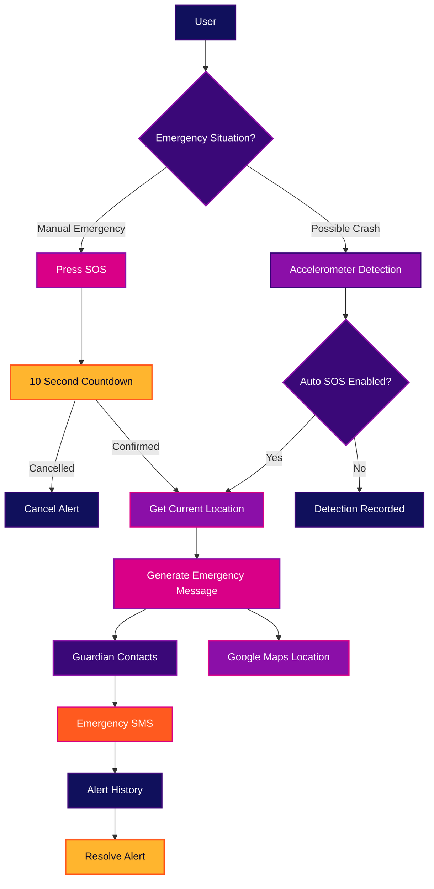
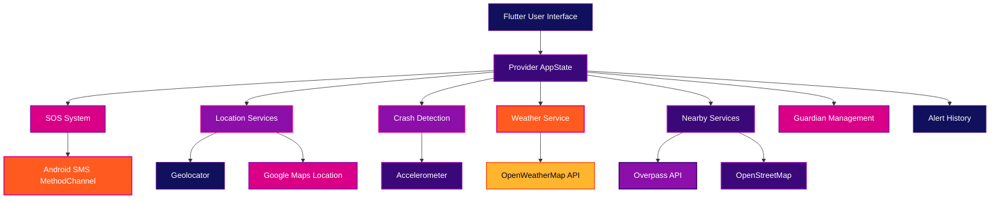
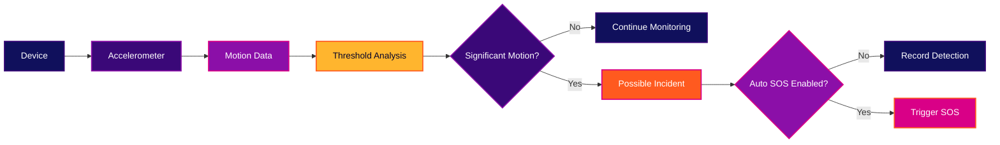
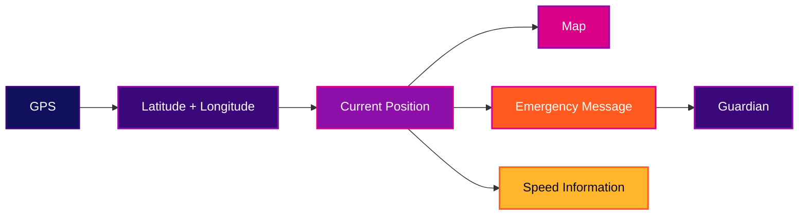
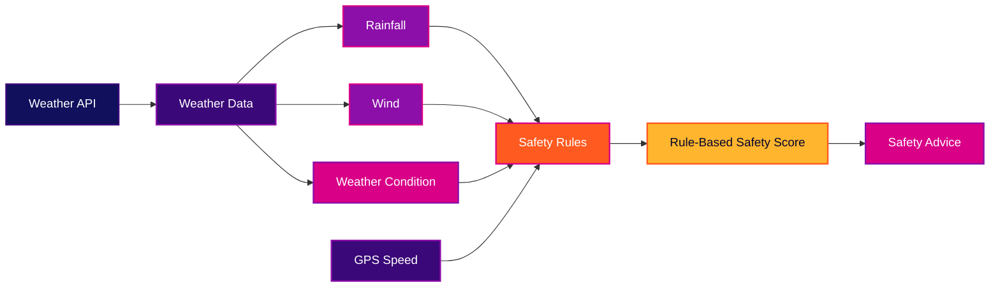
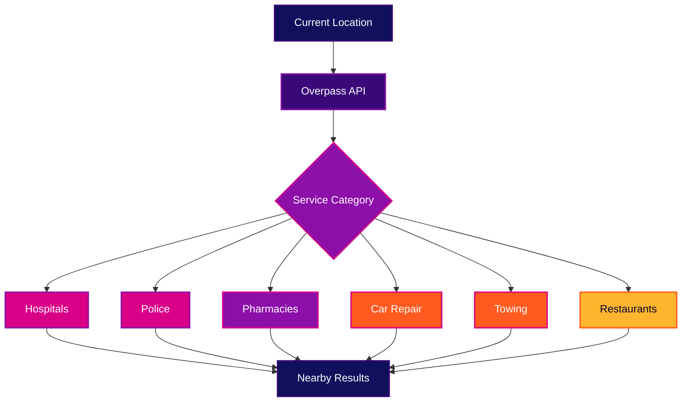
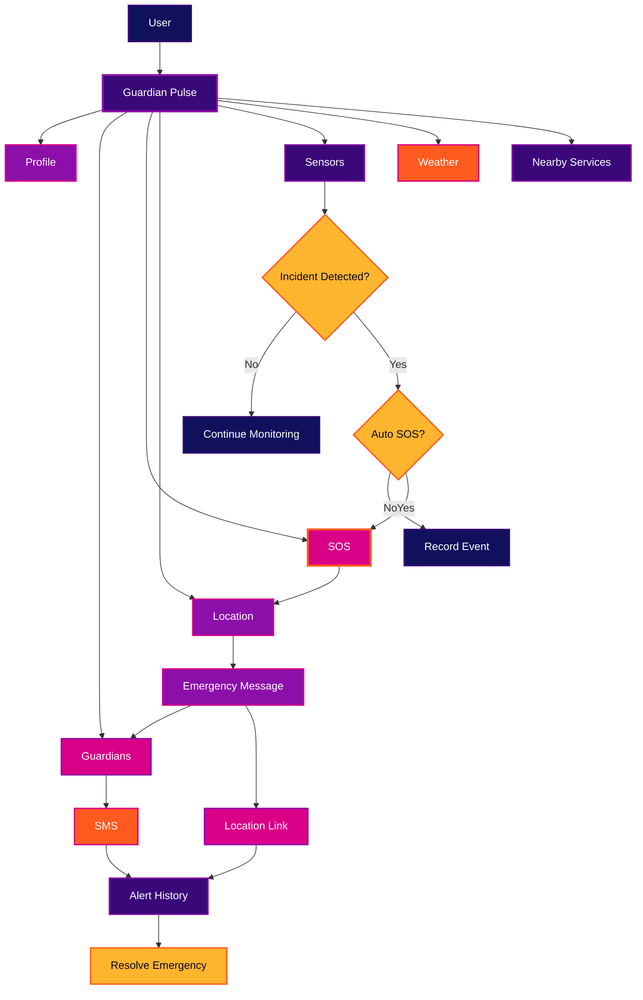

<div align="center">

# 🛡️ Guardian Pulse

### Personal Safety & Emergency Response System

A Flutter-based mobile safety application designed to help users respond quickly to emergencies through SOS alerts, location sharing, crash detection, emergency contacts, weather-based safety analysis, and nearby emergency services.

<br>


<br>

*Detect danger. Locate the user. Alert trusted contacts.*

</div>

---

## About Guardian Pulse

**Guardian Pulse** is a personal safety application built with Flutter.

The application combines emergency communication, GPS tracking, crash detection, environmental information, and nearby-service discovery into a single mobile safety platform.

The main objective is simple:

> **Detect danger → determine the user's situation → alert trusted contacts → provide useful emergency information.**

Guardian Pulse can be used for situations such as:

- Manual emergency situations
- Possible vehicle crashes or sudden impacts
- Location sharing during emergencies
- Emergency SMS communication
- Weather-aware safety information
- Finding nearby emergency services
- Managing trusted guardians
- Maintaining an emergency alert history

---

## Core Features

<table>
<tr>
<td width="50%" valign="top">

### 🚨 SOS Emergency System

- 10-second SOS countdown
- Cancel option before sending
- Immediate SOS option
- Emergency alert history
- Active/resolved alert states
- Emergency message generation
- Guardian notification through SMS

</td>

<td width="50%" valign="top">

### 📍 Location Tracking

- GPS-based location detection
- Current latitude and longitude
- Continuous location updates
- Speed monitoring
- Google Maps location link generation
- Location included in emergency messages

</td>
</tr>

<tr>
<td width="50%" valign="top">

### 🚗 Crash Detection

- Accelerometer-based monitoring
- Sudden movement/shock detection
- Configurable detection threshold
- Automatic SOS option
- Manual control over automatic alerts

</td>

<td width="50%" valign="top">

### 👥 Guardian Management

- Add trusted guardians
- Remove guardians
- Store guardian contact details
- Send emergency alerts to guardians
- Manage emergency communication settings

</td>
</tr>

<tr>
<td width="50%" valign="top">

### 🌦️ Safety & Weather

- Weather information
- Rainfall analysis
- Wind-condition analysis
- Current weather-condition checks
- GPS speed consideration
- Rule-based safety score
- Safety recommendations

</td>

<td width="50%" valign="top">

### 🏥 Nearby Services

Find nearby:

- Hospitals
- Police stations
- Pharmacies
- Car repair services
- Towing services
- Restaurants

Data can be retrieved using OpenStreetMap/Overpass services.

</td>
</tr>
</table>

---

## How Guardian Pulse Works

Guardian Pulse combines manual emergency activation with sensor-based incident detection.



---

## Application Architecture

Guardian Pulse uses Flutter for the application interface and Provider for centralized application state.

The main application state coordinates profile information, guardians, SOS activity, location, crash detection, weather information, nearby services, and alert history.

<table>
<tr>
<td width="50%" valign="top">

### Flutter Layer

```text
Flutter UI
   │
   ▼
Provider / AppState
   │
   ├── Profile
   ├── Guardians
   ├── SOS
   ├── Location
   ├── Crash Detection
   ├── Weather
   ├── Nearby Services
   └── Alert History
```

</td>

<td width="50%" valign="top">

### Service Layer

```text
AppState
  │
  ├── Geolocator
  ├── Accelerometer
  ├── Android SMS
  ├── OpenWeatherMap
  ├── OpenStreetMap
  └── Overpass API
```

</td>
</tr>
</table>



---

## Emergency Response Flow

Guardian Pulse uses multiple paths to enter the emergency-response system.

<table>
<tr>
<td width="33%" valign="top">

### 01 — DETECT

An emergency can begin through:

- Manual SOS
- Possible crash
- Sudden movement
- User-initiated emergency

</td>

<td width="33%" valign="top">

### 02 — LOCATE

The application retrieves:

- Latitude
- Longitude
- Current speed
- Current GPS position

</td>

<td width="33%" valign="top">

### 03 — ALERT

The application can:

- Generate an emergency message
- Contact guardians
- Send SMS
- Provide a map location

</td>
</tr>
</table>

---

## SOS Emergency System

The SOS system provides a controlled emergency activation process.

### SOS Sequence

```text
SOS BUTTON
     │
     ▼
10 SECOND COUNTDOWN
     │
     ├──────────────► CANCEL
     │
     ▼
CONFIRM EMERGENCY
     │
     ▼
GET CURRENT LOCATION
     │
     ▼
GENERATE ALERT
     │
     ▼
SEND TO GUARDIANS
     │
     ▼
STORE ALERT HISTORY
```

### Emergency Message

The emergency SMS can contain:

| Information | Purpose |
|---|---|
| User Name | Identifies the user |
| Blood Group | Emergency reference |
| Alert Type | Manual or accident-related alert |
| Coordinates | Current location |
| Maps Link | Allows guardians to view location |
| Alert Status | Indicates emergency state |

Example:

```text
EMERGENCY ALERT

Name: [User Name]
Blood Group: [Blood Group]

Alert Type: [Manual / Accident]

Current Location:
https://maps.google.com/?q=[LATITUDE],[LONGITUDE]

Please check on the user immediately.
```

---

## Crash Detection

Guardian Pulse uses the device accelerometer to monitor movement and detect possible sudden impacts.



### Detection Process

```text
Accelerometer
     │
     ▼
Motion Data
     │
     ▼
Threshold Comparison
     │
     ▼
Possible Impact
     │
     ▼
Auto SOS Decision
     │
     ▼
Emergency Response
```

> **Note:** Accelerometer-based detection can produce false positives or miss some incidents. It should not be treated as a certified crash-detection system.

---

## Location Tracking

Location is a central component of Guardian Pulse.

The application can obtain:

- Current latitude
- Current longitude
- Current speed
- Continuous position updates
- Location information for emergency messages



The emergency location can be represented as a Google Maps URL so that guardians can open the location directly.

---

## Guardian Management

Guardians are trusted contacts who can receive emergency notifications.

<table>
<tr>
<td width="33%" align="center">

### ADD

**ADD**

Add a trusted emergency contact.

</td>

<td width="33%" align="center">

### MANAGE

**MANAGE**

Manage guardian information and emergency communication settings.

</td>

<td width="33%" align="center">

### ALERT

**ALERT**

Send emergency information when an SOS event occurs.

</td>
</tr>
</table>

---

## Safety & Weather Analysis

Guardian Pulse can retrieve weather information and combine it with other contextual information to produce a simple rule-based safety assessment.

### Factors Considered

| Factor | Purpose |
|---|---|
| Rainfall | Identify rainfall conditions |
| Wind | Identify wind conditions |
| Weather | Understand current conditions |
| GPS Speed | Add movement context |
| Location | Associate conditions with the user |



> The safety score is an informational, rule-based indicator. It is not an official weather warning, medical assessment, or predictive safety system.

---

## Nearby Emergency Services

Guardian Pulse can query geographic data to identify nearby useful services.

Supported categories can include:

- Hospitals
- Police stations
- Pharmacies
- Car repair services
- Towing services
- Restaurants



Nearby-service availability depends on the geographic data returned by OpenStreetMap/Overpass.

---

## Technology Stack

<table>
<tr>
<th>Technology</th>
<th>Purpose</th>
</tr>

<tr>
<td>Flutter</td>
<td>Cross-platform application development</td>
</tr>

<tr>
<td>Dart</td>
<td>Application programming language</td>
</tr>

<tr>
<td>Provider</td>
<td>Application state management</td>
</tr>

<tr>
<td>Geolocator</td>
<td>GPS and location services</td>
</tr>

<tr>
<td>sensors_plus</td>
<td>Accelerometer and motion detection</td>
</tr>

<tr>
<td>permission_handler</td>
<td>Runtime permission management</td>
</tr>

<tr>
<td>flutter_map</td>
<td>Map interface</td>
</tr>

<tr>
<td>latlong2</td>
<td>Latitude and longitude handling</td>
</tr>

<tr>
<td>http</td>
<td>External API communication</td>
</tr>

<tr>
<td>url_launcher</td>
<td>Opening external links</td>
</tr>

<tr>
<td>google_fonts</td>
<td>Application typography</td>
</tr>

<tr>
<td>flutter_animate</td>
<td>UI animation</td>
</tr>

</table>

---

## External Services

<table>
<tr>
<th>Service</th>
<th>Purpose</th>
</tr>

<tr>
<td>OpenWeatherMap</td>
<td>Weather information</td>
</tr>

<tr>
<td>OpenStreetMap</td>
<td>Geographic and map data</td>
</tr>

<tr>
<td>Overpass API</td>
<td>Nearby service discovery</td>
</tr>

<tr>
<td>Google Maps</td>
<td>Emergency location links</td>
</tr>

<tr>
<td>Android SMS</td>
<td>Emergency communication</td>
</tr>

</table>

---

## Application Experience

<table>
<tr>

<td width="50%" valign="top">

### Theme

- Light mode
- Dark mode
- Theme switching
- Consistent application styling

</td>

<td width="50%" valign="top">

### Settings

- Auto SOS
- SMS controls
- Permission controls
- Application preferences

</td>

</tr>

<tr>

<td width="50%" valign="top">

### Alert History

- Active alerts
- Resolved alerts
- Emergency records
- Status tracking

</td>

<td width="50%" valign="top">

### Profile

- User information
- Blood group
- Emergency information
- Guardian details

</td>

</tr>
</table>

---

## Project Structure

```text
GuardianSOSfinal/
│
├── android/
│   └── Android platform implementation
│
├── ios/
│   └── iOS platform implementation
│
├── linux/
│   └── Linux platform implementation
│
├── macos/
│   └── macOS platform implementation
│
├── web/
│   └── Web platform implementation
│
├── windows/
│   └── Windows platform implementation
│
├── assets/
│   └── Application assets
│
├── lib/
│   ├── main.dart
│   │
│   └── services/
│       └── app_state.dart
│
├── test/
│   └── Application tests
│
├── pubspec.yaml
├── pubspec.lock
├── analysis_options.yaml
└── README.md
```

---

## Getting Started

### Requirements

Before running Guardian Pulse, install:

- Flutter SDK
- Dart SDK
- Android Studio
- Android SDK
- Git
- Android emulator or physical Android device

Check Flutter:

```bash
flutter --version
```

Check the development environment:

```bash
flutter doctor
```

---

### 1. Clone the Repository

```bash
git clone https://github.com/harsini2006/GuardianSOSfinal.git
```

```bash
cd GuardianSOSfinal
```

---

### 2. Install Dependencies

```bash
flutter pub get
```

---

### 3. Check Connected Devices

```bash
flutter devices
```

---

### 4. Run the Application

```bash
flutter run
```

To run on a specific device:

```bash
flutter run -d <device-id>
```

---

## Build APK

Generate a release APK using:

```bash
flutter build apk --release
```

The generated APK will be available under:

```text
build/app/outputs/flutter-apk/
```

---

## Development Commands

### Analyze the Project

```bash
flutter analyze
```

### Run Tests

```bash
flutter test
```

### Format Dart Code

```bash
dart format .
```

---

## Permissions

Guardian Pulse may request the following permissions depending on the features being used.

<table>
<tr>
<th>Permission</th>
<th>Purpose</th>
</tr>

<tr>
<td>Location</td>
<td>GPS position and emergency location</td>
</tr>

<tr>
<td>SMS</td>
<td>Emergency message delivery</td>
</tr>

<tr>
<td>Sensors</td>
<td>Crash/shock detection</td>
</tr>

<tr>
<td>Internet</td>
<td>Weather and nearby-service APIs</td>
</tr>

</table>

Permissions should be granted only when the corresponding functionality is required.

---

## Security & Privacy

Guardian Pulse may process information such as:

- User profile information
- Location information
- Emergency contacts
- Blood group information
- Emergency alert history

### Important

> **Never commit API keys, passwords, tokens, or private credentials to GitHub.**

External API credentials should be stored using an appropriate secure configuration mechanism before production deployment.

---

## Limitations

Guardian Pulse is a project/prototype and should not be treated as a certified emergency-response system.

### Location

GPS accuracy depends on device hardware, signal availability, permissions, and environmental conditions.

### Crash Detection

Accelerometer-based detection may produce false positives or miss some incidents.

### SMS

Emergency SMS functionality depends on Android permissions and device capabilities.

### Weather

Weather information depends on external API availability and internet connectivity.

### Nearby Services

Nearby-service results depend on OpenStreetMap/Overpass data availability and accuracy.

### Emergency Response

Guardian Pulse does not replace professional emergency services.

---

## Platform Support

| Platform | Status |
|---|---|
| Android | Primary target |
| iOS | Platform available; feature parity may require additional implementation |
| Web | Platform available; device-specific features differ |
| Windows | Platform available |
| macOS | Platform available |
| Linux | Platform available |

The Android implementation is the primary target for emergency SMS functionality because it uses an Android-native MethodChannel.

---

## Development Workflow


---

## Future Improvements

<table>
<tr>
<td width="50%" valign="top">

### Security

- Secure authentication
- Secure API configuration
- Improved privacy controls
- Protected emergency data

### Connectivity

- Cloud synchronization
- Push notifications
- Guardian-side monitoring
- Secure alert storage

</td>

<td width="50%" valign="top">

### Intelligence

- Improved crash detection
- Better incident classification
- Advanced safety analysis
- Improved offline support

### Emergency Response

- Direct emergency calling
- Expanded emergency contacts
- Improved location sharing
- Faster alert delivery

</td>
</tr>
</table>

---

## Complete System Flow



---

## Project Summary

<table>
<tr>

<td width="33%" align="center">

### DETECT

Identify potential emergencies through manual SOS or motion-based detection.

</td>

<td width="33%" align="center">

### RESPOND

Collect location information and communicate the emergency to trusted guardians.

</td>

<td width="33%" align="center">

### INFORM

Provide weather, nearby-service, and alert-history information around the event.

</td>

</tr>
</table>

---

<div align="center">

# 🛡️ Guardian Pulse

### Stay Alert. Stay Connected. Stay Safe.

**Built with Flutter & Dart**

</div>
